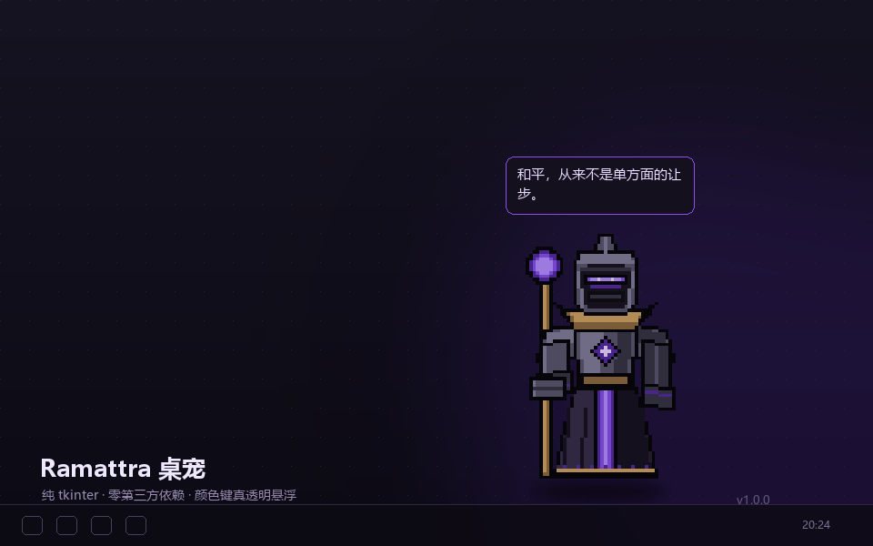
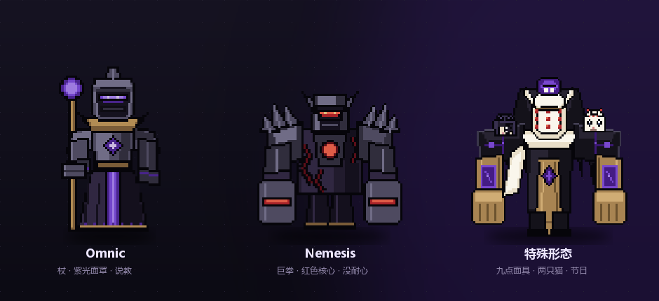

# Ramattra 桌宠 · Ramattra Desktop Pet

> 一个住在你桌面上的拉玛刹。纯 `tkinter`，**零第三方运行时依赖**，双击即用。
> 单击它会说话，双击它在 **Omnic → Nemesis → 特殊形态** 之间换装，拖到哪儿它就在哪儿待着。
> 特殊形态肩上蹲着两只猫，戳它们会理你。



---

## 它能做什么

| 交互 | 反应 |
|---|---|
| **单击** | 说一句台词，并播放施法 / 咆哮 / 灵光动画 |
| **双击** | 循环切换三种形态；窗口以"脚"为锚点缩放，不会跳走 |
| **点猫**（特殊形态） | 戳肩上的两只猫，它们会眨眼，并由它们替你回话 |
| **拖拽** | 随意移动，自动限制在虚拟桌面范围内（多显示器也认） |
| **右键** | 菜单：说句话 / 三种形态 / 打盹 / 总在最前 / 关于 / 退出 |
| **闲置 4–9 秒** | 随机眨眼，面罩光带或眼缝会暗一下 |
| **闲置 5 分钟** | 打瞌睡，点一下就叫醒 |
| **移动后** | 位置和形态写进配置，下次启动还在原地 |

三种形态：



| | Omnic | Nemesis | 特殊形态 |
|---|---|---|---|
| 造型 | 长袍、权杖、紫色光带面罩 | 巨型护肩、双拳、红色核心 | 九点白面具、金色护臂、紫色符文、两只猫 |
| 台词 | 说教、劝你喝水的僧人 | "别碰。""说重点。" | "嘘。别吵醒它们。" |
| 动作 | 权杖举起，紫色法环扩散 | 红色能量环从核心炸开 | 紫色灵环 + 猫眨眼 |

---

## 快速开始

**需要**：Windows + Python 3.10 以上（安装时勾选 *Add python.exe to PATH*）。没有 `pip install`，没有虚拟环境，没有构建步骤。

```bash
git clone https://github.com/subarudesu258/ramattra-desktop-pet.git
cd ramattra-desktop-pet
```

然后**双击 `run.vbs`**（无控制台闪窗）或 `run.bat`。

也可以：

```bash
pythonw -m ramattra_pet
```

想开机自启：`Win + R` → `shell:startup` → 把 `run.vbs` 的快捷方式丢进去。

---

## 为什么它真的"透明"

大多数"网页桌宠"只能待在一个浏览器窗口里。这个不是。

```
Tk 窗口背景 = #FF00FE（洋红）
        ↓  wm_attributes("-transparentcolor", "#FF00FE")
Windows 把它当作 layered window 的颜色键
        ↓
这个颜色的像素 = 完全透明 + 鼠标穿透
```

精灵图全部烘焙在洋红底色上（运行时不做 alpha 混合），窗口本身就是"一块形状不规则的东西"，
点空白处会直接点到后面的桌面图标。再配合 `overrideredirect(True)` 去掉标题栏和任务栏按钮、
`-topmost` 保持置顶，看起来就像桌面上多了个活物。

精灵在 1:1 像素网格上手绘，再用 **NEAREST** 放大 3 倍，所以边缘永远是硬边、不会糊。
三套形态共用一套动画时钟：`idle`（8 帧循环）、`blink`、`action`、`sleep`，特殊形态多一条 `cat`。

---

## 工程结构

```
ramattra-desktop-pet/
├─ run.vbs / run.bat        双击启动（vbs 走 pythonw，无黑窗）
├─ ramattra_pet/
│  ├─ __main__.py           命令行入口：--reset --form --selftest --snapshot --say
│  ├─ app.py                窗口、拖拽、动画时钟、菜单、状态机
│  ├─ sprites.py            帧加载与缓存（manifest.json → tk.PhotoImage）
│  ├─ hotspots.py           可点击区域（猫的命中框，纯数据）
│  ├─ quotes.py             台词库（Omnic / Nemesis / 特殊形态 三套语气）
│  └─ config.py             配置读写，多级目录回退（APPDATA → LOCALAPPDATA → 家用目录）
├─ assets/                  60 张预生成帧（omnic/ nemesis/ special/）+ manifest.json
├─ tools/
│  ├─ art.py                像素画定义（Pillow 绘制，调色板 + 三形态）
│  ├─ gen_sprites.py        生成 assets/ 与预览拼图
│  └─ mock_desktop.py       生成 README 用的合成效果图
├─ docs/                    README 用的效果图 + 开发记录
├─ tests/                   22 个单元测试
└─ .github/workflows/ci.yml Windows 矩阵构建：跑测试 + 重新生成精灵 + 启动自检
```

**运行时依赖**：`tkinter`（标准库）。
**构建期依赖**：Pillow —— 只有重新生成精灵图时才需要，成品仓库里已经带好 PNG。

---

## 开发

```bash
python -m unittest discover -s tests -t . -v   # 22 个测试
python tools/gen_sprites.py                    # 重新烘焙全部精灵帧
python -m ramattra_pet --selftest              # 加载全部素材并开窗自检
python -m ramattra_pet --form special --say "九次日出" --snapshot shot.png
```

测试里最有价值的几条：

1. **颜色键不变量** —— 每张 PNG 必须是 `RGB`（不能有 alpha），四角必须是 `#FF00FE`，且透明面积占比 > 5%。
   改了美术但忘了烘焙，或者误存成 RGBA，测试立刻红。
2. **`app.CLIPS` ↔ `manifest.json` 一致性** —— 代码里引用了一个没生成的动画名（比如 `special_cat` 忘了烘焙），单测直接抓住。
3. **命中框不出画布** —— 猫的点击区域必须落在精灵图内，且左右两只不重叠。

---

## 已知限制 / Roadmap

- **仅 Windows**。透明色键是 Win32 layered window 的特性；macOS / Linux 需要另写窗口层（欢迎 PR）。
- 精灵是 3 倍固定缩放，高分屏下不能用滚轮调大小。
- 没有音效（不想在仓库里塞版权音频）。
- 全局热键（比如 `Ctrl+Alt+R` 召唤）需要 `RegisterHotKey`，还没做。
- 特殊形态的猫只有眨眼反应，还没有"被戳烦了跑掉"的动画。

对应的 issue 都开在仓库里了，欢迎认领。

---

## 关于素材与授权

- 代码：MIT，见 [LICENSE](LICENSE)。
- 像素画：`tools/art.py` 用几何图元原创绘制，**没有使用任何 Overwatch 官方素材**。
  特殊形态的配色与元素（九点面具、金色护臂、肩上两只猫）参考了社区流传的皮肤同人图，
  但每一像素都是本项目自己画的。
- 台词：粉丝二创改写，不是游戏内语音文本的逐字复制。
- Ramattra 及相关角色属于 Blizzard Entertainment。本项目为非商业同人作品，与 Blizzard 无关。

---

<details>
<summary>English summary</summary>

A desktop pet of Ramattra (Overwatch 2), written in pure Python + tkinter with
**no runtime dependencies**. It uses the Windows colour-key trick
(`-transparentcolor`) for genuine per-pixel transparency and click-through, so it
sits on your desktop instead of inside a window.

Click to talk, double-click to cycle **Omnic → Nemesis → Special**, drag to move,
right-click for the menu. In the special (nine-tailed) form two cats sit on the
shoulders — poke them and they blink and answer for themselves. Position and form
persist; it blinks, naps after five idle minutes and mutters to itself.

Sprites are hand-authored on a 1:1 pixel grid in `tools/art.py` (geometry only,
no game assets), baked to PNG by `tools/gen_sprites.py`, and shipped in `assets/`
so end users never need Pillow. CI runs the unit tests, regenerates the sprites
and boots the app on `windows-latest`.

MIT licensed. Fan project, not affiliated with Blizzard.

</details>
